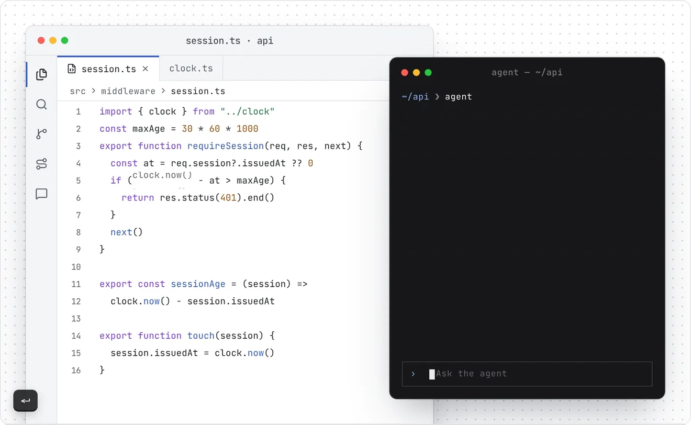

<div align="center">

<picture>
  <source media="(prefers-color-scheme: dark)" srcset="docs/brand/mark-dark.svg">
  
</picture>

# Zero

**The code viewer for the agentic era.**

[Website](https://zero.hoplabs.dev) · [Docs](https://zero.hoplabs.dev/docs/) · [Install](#install) · [CLI reference](docs/cli.md)

[](https://github.com/flexdinesh/zero/releases/latest)
[](LICENSE)

<picture>
  <source media="(prefers-color-scheme: dark)" srcset="docs/readme/cover-dark.webp">
  
</picture>

<sub>Comment on a line, ask your agent to resolve it, and watch the fix and its reply land in zero.</sub>

</div>

Browse files and review what agents change: diffs, commits, branches, and the
walkthroughs agents publish. Comment on a line and the agent answers in the
thread. Read-only and lean. Desktop app, browser, or a remote box served to
your laptop.

## Quick start

```sh
curl -fsSL https://raw.githubusercontent.com/flexdinesh/zero/main/scripts/install.sh | sh
zero .
```

macOS and Linux. Opens the current folder in the desktop app, or the browser
when the app is not installed.

## Features

### Browse any file

Every file in a folder, one command away. Markdown and images render, JSON and
YAML format on demand, and everything else opens as highlighted source. Search
names and content; go to definition through your language servers.
[Browsing →](https://zero.hoplabs.dev/docs/browsing/)

### Review like a pull request

Uncommitted work, commits, branches against any base, and commit ranges in one
stacked diff, with line counts and Viewed marks. Inline blame, file history,
and commit search. Changes refresh live while an agent works.
[Source Control →](https://zero.hoplabs.dev/docs/browsing/#source-control)

### Agents walk you through their changes

An agent publishes a guided tour of the files and diffs it touched. Each step
opens its lines, with the story in a panel above them. Steps pinned to a commit
never move; if code drifts, the step says so instead of guessing.

```sh
zero walkthrough publish walkthrough.json
```

[Walkthroughs →](https://zero.hoplabs.dev/docs/walkthroughs/)

### Tell the agent what to fix, on the line

Comment on diff lines, a whole file, or Source. The agent reads the open
threads with the CLI, makes the changes, and replies in each thread; replies
appear beside the code as they land. Threads follow their code across edits and
stay on your machine.

```sh
zero feedback show
```

[Review feedback →](https://zero.hoplabs.dev/docs/feedback/)

### Serve a remote box to your laptop

Run zero with `--remote` beside the files, then `zero connect` on your
computer. The desktop app opens that machine in its own window over pinned TLS
with a token. The host needs only the CLI. Tailscale, Docker, and running
containers work too. [Remote hosts →](https://zero.hoplabs.dev/docs/remote/)

### Lean by construction

One Go binary with its web app embedded. The desktop app uses the OS web view,
not Electron. Files are never written, and git objects are read directly, never
through the git binary.

## Teach your agent

Skills that teach coding agents to publish walkthroughs and answer review
feedback:

```sh
npx skills add flexdinesh/zero --skill zero-walkthrough
npx skills add flexdinesh/zero --skill zero-feedback
```

## Install

macOS and Linux, no sudo, no runtime needed. Installs to `~/.local/bin` (or `~/bin`).

```sh
# CLI and desktop app (Linux needs WebKitGTK 4.1)
curl -fsSL https://raw.githubusercontent.com/flexdinesh/zero/main/scripts/install.sh | sh
# CLI only
curl -fsSL https://raw.githubusercontent.com/flexdinesh/zero/main/scripts/install.sh | sh -s -- --cli-only
# choose an unused CLI name
curl -fsSL https://raw.githubusercontent.com/flexdinesh/zero/main/scripts/install.sh | sh -s -- --name my-zero
# uninstall everything (keeps user data)
curl -fsSL https://raw.githubusercontent.com/flexdinesh/zero/main/scripts/uninstall.sh | sh
```

Update with `zero update` (or run the script again). Latest `main` builds: see
[development](docs/development.md#install-from-main).

<details>
<summary>Command name collisions and existing installs</summary>

The canonical command is `zero`. If it collides, the installer offers available
`zero-cli` through the terminal; without a terminal it stops and requires
`--name NAME`. Updates and uninstall remember the chosen name. Substitute it for
`zero` in commands below. An alternate CLI name leaves the desktop app,
protocols, and config names canonical. See
[installation details](https://zero.hoplabs.dev/docs/getting-started/#command-name-collisions),
including the limit on detecting shell aliases and functions.

Existing srcz installs and data stay untouched; Zero starts with fresh
settings, tabs, roots, connections, and walkthroughs.

</details>

## Ways to run

| Where | Command |
| --- | --- |
| One project | `zero .` |
| Many repositories | `zero ~/code` or `zero --path ~/code --path ~/oss` |
| Another machine | `zero ~/code --remote` on the host, `zero connect <string>` on your computer |
| Tailscale | `zero ~/code --tailscale` |
| Browser only | `zero browser .` |
| Docker | `docker run ... ghcr.io/flexdinesh/zero` |
| A running container | `zero attach docker://<container>/src` |

`zero --help` lists every command; see the [CLI reference](docs/cli.md).

<details>
<summary>One project</summary>

```sh
zero .            # open in the desktop app (falls back to the browser)
```

Run it in a repository or any folder. When the repository has worktrees, click
the branch in the explorer header (or press → on its picker entry) to switch;
worktrees open wherever they live, even outside the served directory.

</details>

<details>
<summary>Many repositories</summary>

```sh
zero ~/code                     # every git repository under ~/code
zero --path ~/code --path ~/oss # several directories
```

Zero finds repositories and their worktrees up to `--scan-depth` folders deep
(default 10) and lists them in the project picker (Cmd/Ctrl+O). Pick a
repository, then a worktree by branch.

</details>

<details>
<summary>Another machine (LAN, VPN, Tailscale)</summary>

```sh
# on the host, over ssh is fine; it keeps serving after you log out
zero ~/code --remote
# on your computer: the line the host printed
zero connect '10.0.0.5:7971/<credential>/home/me/code'
```

`zero connect` opens the host in its own desktop app window, on the folder
`--remote` was given. The printed addresses are a guess; any route to the port
works:

```sh
zero connect --host mybox <string>       # a Tailscale MagicDNS name or other host name
ssh -L 7971:localhost:7971 mybox         # or tunnel the port yourself
zero connect --host localhost <string>
```

On the host, `zero remote status` prints the string again without a folder (its
window asks which project to open), `zero remote stop` stops serving, and
`zero remote rotate` invalidates old strings. The string is a password: traffic
is TLS pinned to it and every request carries its token. `--web` also prints a
browser link. See [remote hosts](https://zero.hoplabs.dev/docs/remote/).

</details>

<details>
<summary>Tailscale</summary>

```sh
zero ~/code --tailscale   # prints https://<machine>.<tailnet>.ts.net:7971/
```

Open the printed link in a browser on any device in your tailnet: real HTTPS,
no string. Your tailnet's access rules decide who can connect, and anyone they
let in can read the served files. Zero runs `tailscale serve` while it serves
and leaves nothing behind; `zero remote status|stop` manage it. Needs HTTPS
Certificates on for the tailnet; on Linux, `sudo tailscale set --operator=$USER`
once. See [remote hosts](https://zero.hoplabs.dev/docs/remote/#tailscale).

</details>

<details>
<summary>Browser only</summary>

```sh
zero browser .    # serve on localhost and open the browser
```

</details>

> [!WARNING]
> `zero browser --host <address>` serves plain http with **no authentication**:
> anyone who can reach the address can read the files. Prefer `--remote`.

<details>
<summary>Docker</summary>

```sh
docker run --rm -p 127.0.0.1:7971:7971 -v "$PWD:$PWD" -w "$PWD" \
  --user "$(id -u):$(id -g)" ghcr.io/flexdinesh/zero
```

Open http://localhost:7971. The image (`latest` or `<version>`) runs
`zero browser`: plain http with no authentication. `127.0.0.1:` keeps the port
on this machine. The directory mounts at its own path because linked worktrees
store absolute host paths; run it from a directory that holds the repository
and its worktrees. `--user` reads files as you.

To serve to another machine over TLS, run the server in the foreground and keep
its identity in a config volume, so the string survives restarts:

```sh
mkdir -p ~/.config/zero-docker
docker run --rm -p 127.0.0.1:7971:7971 -v "$PWD:$PWD" -w "$PWD" \
  --user "$(id -u):$(id -g)" -v "$HOME/.config/zero-docker:/tmp/.config/zero" \
  ghcr.io/flexdinesh/zero . --remote --foreground
zero connect --host localhost <string>   # the printed string names the container's address
```

`--foreground` never stops on its own; `docker stop` ends it.

</details>

> [!WARNING]
> In Docker, `-p 7971:7971` (without `127.0.0.1:`) would serve your files to
> every network the host is on, with no authentication.

<details>
<summary>Attach to a running container</summary>

```sh
zero attach docker://<container>/src             # open /src of a running container in the desktop app
zero attach --browser docker://<container>/src   # or in a web browser
```

zero copies itself into the container's `/tmp/.zero` (no shell needed). With the
desktop app installed, the container gets its own window, which runs zero there
while it is open. Otherwise, or with `--browser`, zero serves it on `127.0.0.1`
and removes the copy on Ctrl-C. See [remote hosts](https://zero.hoplabs.dev/docs/remote/#containers).

</details>

## Docs

- [User guides](https://zero.hoplabs.dev/docs/)
- [CLI reference](docs/cli.md)
- [Development](docs/development.md), [architecture](docs/architecture.md), [release](docs/release.md)

## License

[MIT](LICENSE)
